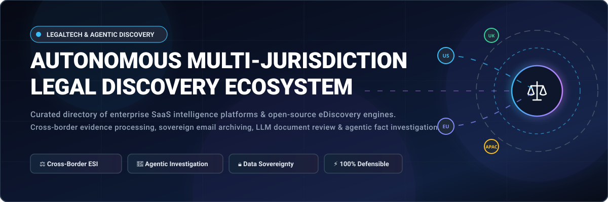

<div align="center">



# ⚖️ Awesome Autonomous Multi-Jurisdiction Legal Discovery 🤖

<a href="https://github.com/ishandutta2007/Awesome-Awesome-Awesome"></a><a href="https://discord.gg/jc4xtF58Ve"></a>
[](https://github.com/ishandutta2007/Awesome-Awesome-Awesome)
[](https://creativecommons.org/publicdomain/zero/1.0/)
[](https://github.com/ishandutta2007/Awesome-Autonomous-Multi-Jurisdiction-Legal-Discovery/pulls)
[](https://github.com/ishandutta2007/Awesome-Autonomous-Multi-Jurisdiction-Legal-Discovery/graphs/commit-activity)
[](#-saas-enterprise-platforms)
<a href="https://github.com/ishandutta2007"></a>

**The definitive curated directory of SaaS intelligence platforms and open-source software for cross-border electronic discovery (eDiscovery), agentic fact investigation, sovereign document archiving, and multilingual litigation support.**

[🌐 Sector Dynamics](#-sector-overview--market-dynamics) • [💼 SaaS Platforms](#-saas-enterprise-platforms) • [💻 Open-Source Projects](#-open-source-github-projects) • [🛡️ Compliance Architecture](#-cross-border--multi-jurisdiction-compliance-frameworks) • [🤝 Contributing](#-how-to-contribute) • [💖 Support](#-support--sponsorship) • [📈 Star History](#--star-history)

</div>

---

## 📌 Introduction & Scope

Modern cross-border litigation and regulatory investigations require legal teams to process, search, analyze, and review terabytes of **Electronically Stored Information (ESI)** across distinct national jurisdictions, data privacy mandates (such as **EU GDPR**, **California CCPA**, **UK GDPR**, and **Swiss FADP**), and foreign language barriers. 

This repository tracks the leading **Enterprise SaaS Platforms** and **Sovereign Open-Source Engines** that power **Autonomous Multi-Jurisdiction Legal Discovery**. These tools leverage artificial intelligence, large language models (LLMs), agentic fact investigation reasoning, and forensically sound workflows to deliver defensible evidence identification at scale.

---

## 📊 Sector Overview & Market Dynamics

> 💡 **Market Size:** The global eDiscovery market was valued at **$18.73 billion to $19.61 billion in 2025** and is projected to surpass **$20.74 billion in 2026**, expanding at a Compound Annual Growth Rate (CAGR) between **7.4% and 10.5%** through 2030, driven by the exponential growth of enterprise communications (M365, Slack, Teams) and the integration of generative AI.

> ⚖️ **Market Structure & Fragmentation:** The sector demonstrates a **moderately concentrated upper tier alongside a highly fragmented long tail** rather than a winner-take-all monopoly. While a handful of dominant enterprise titans (e.g., *Relativity, Everlaw, Exterro, Reveal*) anchor Fortune 500 litigation and national Department of Justice budgets, the market remains resiliently fragmented:
> 
> * **Data Sovereignty & Cross-Border Blocking Statutes:** Many international jurisdictions (e.g., France, Germany, China, Switzerland) prohibit cross-border data exfiltration, mandating localized, self-hosted, or air-gapped regional infrastructure.
> * **Boutique Specialization:** Niche litigation support firms, investigative journalism collectives, and boutique practices rely on specialized tools and open-source pipelines to inspect proprietary data formats without incurring multi-thousand dollar commercial SaaS minimums.

---

## 💼 SaaS Enterprise Platforms

Below is the comparative breakdown of industry-leading enterprise SaaS platforms for multi-jurisdiction eDiscovery, ranked in descending order of corporate scale (valuation and annual revenue).

### 🏢 SaaS Comparison Matrix

| # | 🏢 Platform | 💰 Scale (Valuation / Revenue) | 🏷️ Specific Starting Pricing | 🎁 Free Tier / Trial Limits | 🌐 Multi-Jurisdiction & AI Highlights |
|---|---|---|---|---|---|
| 1 | **[Relativity](https://relativity.com/)** | **$3.6 Billion Valuation**<br>*(~$450M+ ARR, Silver Lake backed)* | Starting at **$15,000 to $50,000/yr** base enterprise direct commitment; or **$15–$35/GB/month** active hosting via certified channel partners (Relativity aiR includes unlimited review seats) | **30-day custom POC sandbox trial** (limited to 5–10 GB sample dataset for qualified corporate/firm evaluations; no public self-serve free tier) | Gold-standard eDiscovery in 65+ G2 reports; **Relativity aiR** autonomous multi-step reasoning, global private cloud & on-premise deployments. |
| 2 | **[Everlaw](https://everlaw.com/)** | **$2.0 Billion Valuation**<br>*(Series D, >$100M ARR)* | Starting at **$18.00–$35.00/GB/month** active review hosting (**$3.50/GB/mo** cold archive); includes unlimited user seats, free processing, and unlimited productions (GenAI Deep Dive credits billed separately) | **Free forever plan for 501(c)(3) pro bono litigation** through *Everlaw for Good*; or **30-day sales POC pilot** with scoped client dataset (no public credit-card self-serve tier) | FedRAMP Moderate certified; proven at **10M+ document corpora**; automated coding suggestions & natural-language case interrogation. |
| 3 | **[Exterro](https://www.exterro.com/)** | **$1.0B–$2.5B Valuation**<br>*(PE backed unicorn, ~$150M–$200M ARR)* | Starting at **$50,000/year** enterprise annual subscription (modular licensing across Legal Hold, E-Discovery, In-Review, and FTK forensics) | **30-day guided enterprise evaluation POC** with vendor-provisioned sample data (no self-serve free trial or public free tier) | Comprehensive Legal GRC suite unifying cross-border discovery with GDPR compliance, risk management, and FTK digital forensics. |
| 4 | **[Reveal-Brainspace](https://www.revealdata.com/)** | **$1.0+ Billion Valuation**<br>*(K1 Investment backed; acquired Logikcull & IPRO)* | Starting at **$800.00/user/month** enterprise direct license, or **$8.00–$15.00/GB/month** active review hosting via partner networks (all Brainspace AI visual analytics models bundled) | **14-to-30-day custom enterprise POC sandbox** with sample case data upon sales consultation (no public self-serve free tier) | Visual interactive document clustering, multilingual concept search, cross-jurisdiction data residency (GovCloud, hybrid, on-prem), 190+ SaaS connectors. |
| 5 | **[Nuix Discover](https://www.nuix.com/)** | **AUD $585 Million (~$390M USD) Market Cap**<br>*(ASX: NXL; AUD $263.2M Annual Revenue)* | Starting at **£4.64 (~$6.00 USD)/GB/month** SaaS review hosting (UK G-Cloud benchmark), or Workstation core licenses from **$25,000/year** | **30-day enterprise POC trial license** with pre-loaded forensic sample case files for qualified legal departments (no self-serve free trial) | Trusted by 1,800+ organizations; **Nuix Neo Discover** Cognitive AI (CogAI) with 500+ pre-built review models; native on-premise sovereign capability. |
| 6 | **[KLDiscovery](https://www.kldiscovery.com/)** | **$560M–$600M Enterprise Value**<br>*(OTC: KLDI; ~$324M–$346M Annual Revenue)* | Starting at **$25.00/GB** ingestion processing fee, plus **$12.00–$18.00/GB/month** active hosting on Nebula Cloud (blended per-custodian / managed models available) | **30-day scoped proof-of-concept (POC)** and Early Case Assessment (ECA) pilot on agreed client test dataset (no public self-serve free tier) | Proprietary **Nebula AI Case Explorer** with Agentic Chat; multi-continent data centers across EMEA, APAC, and North America for local data hosting. |
| 7 | **[Casepoint](https://casepoint.com/)** | **$300 Million Est. Valuation**<br>*(~$87.3M ARR; majority acquired by Thoma Bravo)* | Starting at **$15.00–$25.00/GB/month** active data review, or modular application subscription starting at **$1,500.00/month** (Legal Hold, eDiscovery, FOIA) | **30-day custom POC pilot environment** with up to **10 GB test ingestion** for qualified enterprise and government evaluations (no self-serve free tier) | **FedRAMP High & DoD IL6** certified cloud; CaseAssist AI algorithms; built for high-security multinational government and corporate discovery matters. |
| 8 | **[CS DISCO](https://csdisco.com/)** | **~$300 Million Market Cap**<br>*(NYSE: LAW; $156.9M FY2025 Revenue)* | Starting at **$10.00–$20.00/GB/month** all-inclusive consumption hosting (covers ingest, ECA, unlimited user seats, and Cecilia AI generative Q&A at no extra charge) | **50 GB free forever plan** for qualifying 501(c)(3) non-profit pro bono matters; **30-day scoped pilot (capped at 5–15 GB)** for commercial matters | Industry-first scaled **Cecilia AI** agentic multi-step reasoning tool for fact investigation, auto-timelines, deposition summaries, and cross-border review. |
| 9 | **[Logikcull](https://www.logikcull.com/)** | **~$130 Million Valuation**<br>*(Acquired by Reveal/K1; ~$35M–$45M ARR)* | **$40.00/GB/month** pay-as-you-go with a **10 GB monthly minimum ($400.00/month baseline cost floor)**; or flat annual subscriptions starting from **$10,000/year** | **Free forever sample sandbox account** (pre-loaded with interactive mock litigation matter, $0/mo; live upload requires plan selection with 10 GB min) | Intuitive drag-and-drop cloud review, automated virus/PII scanning, instant Bates stamping; ideal for lean legal teams and boutique practices. |
| 10 | **[Nextpoint](https://www.nextpoint.com/)** | **~$80 Million Valuation**<br>*(~$25M Annual Revenue; bootstrapped)* | Starting at **$299.00/user/month** flat rate (Essential tier; includes **unlimited data processing, unlimited hosting, and unlimited productions with $0/GB fees**) | **14-day guided sandbox demo trial** with pre-loaded mock litigation matter upon sales request (no public credit-card self-serve upload tier) | Predictable flat-rate per-user economics; integrated transcript management, litigation timeline creation, and courtroom trial presentation. |

---

## 💻 Open-Source GitHub Projects

Open-source and self-hosted tools provide total **data sovereignty**, **air-gapped processing**, and zero vendor lock-in—indispensable for cross-border matters subject to strict data residency requirements, GDPR blocking statutes, and criminal evidentiary chains of custody.

Below are the top open-source projects for legal discovery, document intelligence, and digital forensics, **ranked strictly in descending order of GitHub Stars_Counts**.

### 🌟 Ranked Open-Source Solutions

1. **[Autopsy (sleuthkit/autopsy)](https://github.com/sleuthkit/autopsy)** [](https://github.com/sleuthkit/autopsy/stargazers)
   * **License:** Apache-2.0 / GPLv2
   * **Primary Focus:** Digital Forensics, ESI Ingestion & File Evidence Analysis
   * **Description:** Autopsy is the premier open-source digital forensics platform and graphical interface to The Sleuth Kit. Extensively deployed by law enforcement, military examiners, and corporate eDiscovery investigators worldwide to reconstruct hard drives, recover deleted communication files, extract EXIF metadata, parse email archives, and maintain forensically sound evidence chains.

2. **[Aleph (alephdata/aleph)](https://github.com/alephdata/aleph)** [](https://github.com/alephdata/aleph/stargazers)
   * **License:** MIT
   * **Primary Focus:** Investigative Search, Cross-Border Leaks & Entity Extraction
   * **Description:** Flagship platform created by the Organized Crime and Corruption Reporting Project (OCCRP). Designed specifically to bulk-index terabytes of multinational public records, leaked documents, and unstructured email caches. Features automated multilingual OCR, cross-dataset entity matching, network graph analysis, and secure collaborative review for cross-border investigations (utilized in the Panama Papers and Suisse Secrets).

3. **[OpenContracts (Open-Source-Legal/OpenContracts)](https://github.com/Open-Source-Legal/OpenContracts)** [](https://github.com/Open-Source-Legal/OpenContracts/stargazers)
   * **License:** MIT
   * **Primary Focus:** Legal Document Intelligence, Contract Discovery & Agentic Vector Graphs
   * **Description:** An open-source document intelligence platform and DMS engineered for legal tech builders and autonomous AI agents. Converts complex legal document corpora (PDFs, DOCX) into structured, citation-grounded vector knowledge graphs that human attorneys and LLM agents can query, cross-examine, annotate, and reason over with pinpoint coordinate accuracy.

4. **[Datashare (ICIJ/datashare)](https://github.com/ICIJ/datashare)** [](https://github.com/ICIJ/datashare/stargazers)
   * **License:** GPL-3.0
   * **Primary Focus:** Sovereign Document Search Engine & Investigative Review
   * **Description:** Developed by the International Consortium of Investigative Journalists (ICIJ). Datashare is a sovereign, self-hosted search engine tailored for investigative document collections. Provides local or centralized document indexing, batch Tesseract OCR, automated named entity recognition (people, companies, locations), and conversational email threading across massive document dumps.

5. **[Overview Server (overview/overview-server)](https://github.com/overview/overview-server)** [](https://github.com/overview/overview-server/stargazers)
   * **License:** Apache-2.0
   * **Primary Focus:** Unstructured Document Mining & Semantic Clustering
   * **Description:** Bulk document exploration and visualization system. Automatically clusters hundreds of thousands of unstructured documents by topic, extracts named entities, and generates hierarchical interactive tree maps. Originally built for investigative journalists, now widely leveraged in legal early case assessment (ECA) and regulatory response.

6. **[Extract (ICIJ/extract)](https://github.com/ICIJ/extract)** [](https://github.com/ICIJ/extract/stargazers)
   * **License:** Apache-2.0
   * **Primary Focus:** High-Throughput Parallel Text & Metadata Extraction CLI
   * **Description:** A cross-platform command-line utility built by the ICIJ for parallelized content extraction, metadata harvesting, and full-text translation pipelines. Operates as an ultra-fast ingestion step for large-scale multi-jurisdiction document dumps before indexing.

7. **[FreeEed (shmsoft/FreeEed)](https://github.com/shmsoft/FreeEed)** [](https://github.com/shmsoft/FreeEed/stargazers)
   * **License:** Apache-2.0
   * **Primary Focus:** Complete Self-Hosted eDiscovery Engine & AI Document Chat
   * **Description:** The most mature dedicated open-source eDiscovery application. Built on Hadoop, Apache Tika, Lucene, and Solr, FreeEed scales from single-machine workloads to multi-terabyte enterprise clusters. Supports 1,400+ file formats (including PST, OST, MBOX, and Office), automated OCR, AI document chat, deduplication, Bates stamping, and Concordance/DAT production set generation.

8. **[FreeDiscovery (FreeDiscovery/FreeDiscovery)](https://github.com/FreeDiscovery/FreeDiscovery)** [](https://github.com/FreeDiscovery/FreeDiscovery/stargazers)
   * **License:** BSD-3-Clause
   * **Primary Focus:** RESTful Machine Learning API for eDiscovery Analytics
   * **Description:** High-performance web service providing machine learning capabilities for eDiscovery workflows. Exposes endpoints for predictive coding (Technology Assisted Review / TAR), email threading, near-duplicate document clustering, and semantic categorization powered by scikit-learn.

9. **[Newsleak (uhh-lt/newsleak)](https://github.com/uhh-lt/newsleak)** [](https://github.com/uhh-lt/newsleak/stargazers)
   * **License:** Apache-2.0
   * **Primary Focus:** Interactive Information Extraction & Investigative Network Discovery
   * **Description:** Investigative software platform engineered for automated information extraction and visual graph analysis of heterogeneous textual datasets in eDiscovery and data leak scenarios. Features entity co-occurrence graphs and timeline tracking.

10. **[OpenDiscoverPlatform Case Study (dotfurther/OpenDiscoverPlatformCaseStudy)](https://github.com/dotfurther/OpenDiscoverPlatformCaseStudy)** [](https://github.com/dotfurther/OpenDiscoverPlatformCaseStudy/stargazers)
    * **License:** MIT
    * **Primary Focus:** Information Governance & RavenDB Search Demonstrator
    * **Description:** Case study and architectural implementation demonstrating the dotfurther Open Discover Platform coupled with a RavenDB document store to deliver rapid full-text search, regulatory discovery, and information governance compliance.

11. **[loadfile (gojefferson/loadfile)](https://github.com/gojefferson/loadfile)** [](https://github.com/gojefferson/loadfile/stargazers)
    * **License:** MIT
    * **Primary Focus:** Legal Load File Conversion (.DAT / Opticon to CSV/JSON)
    * **Description:** Ultra-fast Go CLI utility designed to parse, validate, and convert standard litigation .DAT, Concordance, and Opticon load files into standard CSV and JSON data structures, facilitating smooth ingestion into modern cloud databases and vector stores.

12. **[Sequence (reductech/Sequence)](https://github.com/reductech/Sequence)** [](https://github.com/reductech/Sequence/stargazers)
    * **License:** MIT
    * **Primary Focus:** Legal Workflow Automation & eDiscovery Connector Orchestration
    * **Description:** Workflow automation platform built specifically for legal operations and discovery pipelines. Offers pre-built integrations for Relativity, Nuix, Tesseract OCR, and structured SQL/NoSQL databases to orchestrate automated ingestion and review alerts.

13. **[enigma (McFlip/enigma)](https://github.com/McFlip/enigma)** [](https://github.com/McFlip/enigma/stargazers)
    * **License:** MIT
    * **Primary Focus:** Batch PST Decryption & Ingestion Utility
    * **Description:** Lightweight, high-throughput utility written in Go for automated bulk decryption, credential bypassing, and batch extraction of Microsoft Outlook PST email archives during evidentiary culling.

14. **[rex (rexlit) (bginsber/rex)](https://github.com/bginsber/rex)** [](https://github.com/bginsber/rex/stargazers)
    * **License:** MIT
    * **Primary Focus:** Offline-First UNIX Litigation CLI & AI Privilege Detection
    * **Description:** Offline-first command-line toolkit for litigation management and eDiscovery. Features metadata extraction, full-text indexing, Bates stamping, DAT production exports, deadline calendar calculation, and automated attorney-client privilege classification powered by Groq LLM inferences.

15. **[Open Archiver (nimdassdev/OpenArchiver)](https://github.com/nimdassdev/OpenArchiver)** [](https://github.com/nimdassdev/OpenArchiver/stargazers)
    * **License:** MIT
    * **Primary Focus:** Sovereign Email Archiving & Tamper-Evident Search
    * **Description:** Sovereign email archiving and compliance search platform. Ingests communications from Microsoft 365, Google Workspace, PST, and mbox sources. Features Meilisearch full-text search, conversation threading, deduplication, and cryptographic SHA-256 evidence hashing for strict legal admissibility.

16. **[ps-bates-enumerator (andre-abadi/ps-bates-enumerator)](https://github.com/andre-abadi/ps-bates-enumerator)** [](https://github.com/andre-abadi/ps-bates-enumerator/stargazers)
    * **License:** MIT
    * **Primary Focus:** PowerShell Document Bates Numbering
    * **Description:** Automated PowerShell script for sequentially renaming and stamping evidentiary document batches with standardized alphanumeric Bates numbers prior to court production.

17. **[ps-folderizer (andre-abadi/ps-folderizer)](https://github.com/andre-abadi/ps-folderizer)** [](https://github.com/andre-abadi/ps-folderizer/stargazers)
    * **License:** MIT
    * **Primary Focus:** Ringtail & Nuix Folder Importer
    * **Description:** PowerShell directory structure re-organizer tailored to structure deep folder hierarchies into standardized volume sets for direct import into Nuix Discover and Ringtail eDiscovery databases.

---

## 🛡️ Cross-Border & Multi-Jurisdiction Compliance Frameworks

Conducting electronic discovery across multiple national jurisdictions presents complex legal and regulatory hurdles:

```
               ┌────────────────────────────────────────────────────────┐
               │  Multi-Jurisdiction Electronically Stored Info (ESI)   │
               └──────────────────────────┬─────────────────────────────┘
                                          │
            ┌─────────────────────────────┴─────────────────────────────┐
            ▼                                                           ▼
┌──────────────────────────────┐                            ┌──────────────────────────────┐
│  United States / Common Law  │                            │    European Union / Civil    │
├──────────────────────────────┤                            ├──────────────────────────────┤
│ • Broad FRCP Rule 26 Scope   │                            │ • Strict GDPR Restrictions   │
│ • Cloud-first SaaS Ingestion │                            │ • Blocking Statutes (France) │
│ • Protective Order Secrecy   │                            │ • Sovereign On-Prem Hosting  │
└──────────────┬───────────────┘                            └──────────────┬───────────────┘
               │                                                           │
               └──────────────────────────┬────────────────────────────────┘
                                          │
                                          ▼
                      ┌───────────────────────────────────────┐
                      │    Defensible Autonomous Discovery    │
                      │  • Agentic Fact Verification          │
                      │  • Cryptographic Chain-of-Custody     │
                      │  • Cross-Border Redaction & Privilege │
                      └───────────────────────────────────────┘
```

1. **Conflict of Laws:** US Federal Rules of Civil Procedure (FRCP Rule 26) demand expansive document production, while EU GDPR Article 48 explicitly restricts foreign court access to EU citizen data without specific treaties (such as the EU-U.S. Data Privacy Framework or Hague Evidence Convention).
2. **Blocking Statutes:** Jurisdictions like France (French Blocking Statute) and Switzerland impose criminal penalties for unauthorized evidence gathering destined for foreign proceedings without following formal diplomatic letters rogatory.
3. **Data Sovereignty Architecture:** Deploying self-hosted open-source stacks (such as **FreeEed**, **Aleph**, or **Autopsy**) or sovereign on-premise SaaS modules (such as **Nuix** or **Reveal GovCloud**) guarantees that sensitive evidence never crosses border boundaries before redaction.
4. **Agentic AI Defensibility:** Autonomous reasoning models (like DISCO Cecilia AI or Relativity aiR) accelerate first-pass review by up to 87%, but legal precedent requires verifiable audit trails, confidence scoring, and attorney-supervised sampling for judicial defensibility.

---

## 🔍 SEO & Technical Keywords

`eDiscovery SaaS` • `Electronic Discovery Reference Model (EDRM)` • `Autonomous Legal AI` • `Agentic Fact Investigation` • `Cross-Border Litigation` • `Data Sovereignty` • `GDPR Compliant Discovery` • `PST Decryption` • `Open Source Digital Forensics` • `Legal Load Files (.DAT)` • `Bates Stamping Automation` • `Technology Assisted Review (TAR)` • `Relativity Alternative` • `Self-Hosted eDiscovery` • `Litigation Readiness` • `Privilege Review LLM`

---

## 🤝 How to Contribute

We welcome contributions from legal technologists, litigation support professionals, corporate counsel, and open-source developers!

1. 🍴 **Fork the repository**
2. 🌿 **Create a feature branch:** `git checkout -b feature/new-discovery-tool`
3. 📝 **Add your tool:** Follow the existing tabular or bullet format. Ensure SaaS entries include verified pricing and free tier/pilot terms.
4. 🌟 **Stars_Badges:** For open-source repos, include the social Stars_Badge linking to the stargazers page:
   ```markdown
   [](https://github.com/{owner}/{repo}/stargazers)
   ```
5. 🚀 **Submit a Pull Request** with a concise explanation of the platform's multi-jurisdictional or autonomous discovery capabilities.

---

## 💖 Support & Sponsorship

Thank you for exploring and utilizing **Awesome Autonomous Multi-Jurisdiction Legal Discovery**! ⚖️🤖

If you find this curated legal tech directory and cross-border discovery research helpful:
- ⭐ **Star this repository** to boost visibility across the legal tech and open-source communities!
- 🍴 **Fork the project** to benchmark or integrate into your organization's litigation pipelines!
- 📢 **Share it** with your network on LinkedIn, Twitter/X, and litigation support forums!
- ☕ **Support continuous maintenance:** Consider sponsoring or buying a coffee via the official [GitHub Sponsor Dashboard](https://github.com/sponsors/ishandutta2007):

<div align="center">

<a href="https://github.com/sponsors/ishandutta2007">
  
</a>
&nbsp;&nbsp;
<a href="https://github.com/sponsors/ishandutta2007">
  
</a>

</div>

---

##  Star History

[](https://star-history.dera.page/#ishandutta2007/Awesome-Autonomous-Multi-Jurisdiction-Legal-Discovery&type=date&legend=top-left)

---

## 📜 Disclaimer

*This repository is an educational and informational community-curated resource. Inclusion of a platform or project does not constitute legal counsel or commercial endorsement. When managing litigation evidence across borders, always consult qualified legal counsel regarding local privacy statutes, professional ethics rules, and international evidence conventions.*

---

<div align="center">

**Built with ⚖️ by legal tech practitioners, eDiscovery specialists, and AI engineers.**  
*Empowering sovereign, transparent, and autonomous legal discovery across borders.*

[⭐ Star this repository](https://github.com/ishandutta2007/Awesome-Autonomous-Multi-Jurisdiction-Legal-Discovery) if you find it valuable!

</div>
